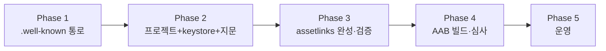

# 안드로이드 웹앱(TWA) 개발 계획 v2

> 대상: 고객사 앱 `client/` → Android TWA(Trusted Web Activity) 패키징
> 기준 URL: `https://insanomutok.com/client/`
> 작성: 2026-09-29

---

## 0. 원칙

1. **서명 키가 먼저다**: `assetlinks.json`에는 앱 서명 인증서의 SHA-256 지문이 들어가므로,
   **keystore 생성 → 지문 추출 → assetlinks 작성 → 배포** 순서로 진행한다.
2. 서빙 통로(`.well-known`)는 지문과 무관하게 먼저 준비한다.
3. 웹 수정만으로 앱이 갱신되는 구조(TWA)를 유지한다 — 앱 재빌드는 서명/패키지 변경 시에만.

---

## Phase 1 — 서빙 통로 준비 (지문 불필요)

### 1-1. `.well-known/assetlinks.json` 서빙

**① `server.js`에 정적 라우트 추가** (security 미들웨어보다 앞):

```js
// ── TWA(Trusted Web Activity) 디지털 자산 링크 검증용 ──
app.use('/.well-known', express.static(path.join(ROOT, '.well-known'), staticOpts));
```

**② 로컬에 자리표시자 파일 생성**: `.well-known/assetlinks.json`

```json
[
  {
    "relation": ["delegate_permission/common.handle_all_urls"],
    "target": {
      "namespace": "android_app",
      "package_name": "com.daehwa.insanomutok",
      "sha256_cert_fingerprints": ["__FILL_SHA256_AFTER_KEYSTORE__"]
    }
  }
]
```

> ⚠️ `__FILL_...__` 상태로는 배포하지 말 것. 지문 확보(Phase 3) 후 교체한다.

### 1-2. 배포 패키지에 포함

`scripts/build-dist.js` 수정:

```js
const DIRS = ['lib', 'routes', 'middleware', 'admin', 'client', '.well-known'];
```

> `copyDir`이 숨김 폴더도 그대로 복사하는지 확인 (`.well-known`은 점으로 시작하는 폴더).

### 1-3. 배포 시 주의

- 재배포 `unzip -o`는 `dist/.well-known/*`를 포함하도록 함 (제외 목록 `-x 'dist/data/*'`만 유지)
- 배포 후 확인: `curl https://insanomutok.com/.well-known/assetlinks.json` → 200 JSON
- Nginx는 `/` 프록시이므로 별도 설정 불필요

### 산출물
- [ ] `server.js` 수정 + 커밋
- [ ] `.well-known/assetlinks.json` (자리표시자)
- [ ] `build-dist.js` 수정 + 커밋
- [ ] 운영 배포 및 200 확인

---

## Phase 2 — Android 프로젝트 + 서명 키 (지문 확보)

### 2-1. 프로젝트 생성

- Android Studio → New Project → **Empty Views Activity**
- 패키지: `com.daehwa.insanomutok` (운영 확정 후 변경 불가 → 신중히 확정)
- minSdk 24 / targetSdk 최신(34+)

### 2-2. TWA 라이브러리 추가

`app/build.gradle`:

```gradle
dependencies {
    implementation 'com.google.androidbrowserhelper:androidbrowserhelper:2.7.3'
}
```

`AndroidManifest.xml` 전체 교체 (공식 `twa-basic` 데모 기준):

```xml
<?xml version="1.0" encoding="utf-8"?>
<manifest xmlns:android="http://schemas.android.com/apk/res/android"
    xmlns:tools="http://schemas.android.com/tools">

    <application
        android:allowBackup="true"
        android:icon="@mipmap/ic_launcher"
        android:label="@string/app_name"
        android:supportsRtl="true"
        android:manageSpaceActivity="com.google.androidbrowserhelper.trusted.ManageDataLauncherActivity"
        android:theme="@android:style/Theme.Translucent.NoTitleBar">

        <!-- 사이트↔앱 소유권 증명 (assetlinks.json과 쌍, Phase 3에서 지문 교체) -->
        <meta-data
            android:name="asset_statements"
            android:resource="@string/asset_statements" />

        <!-- 앱 정보 → 저장공간/사이트 설정 관리 -->
        <activity
            android:name="com.google.androidbrowserhelper.trusted.ManageDataLauncherActivity">
            <meta-data
                android:name="android.support.customtabs.trusted.MANAGE_SPACE_URL"
                android:value="https://insanomutok.com/client/" />
        </activity>

        <!-- TWA 런처 -->
        <activity
            android:name="com.google.androidbrowserhelper.trusted.LauncherActivity"
            android:label="@string/app_name"
            android:exported="true">
            <meta-data
                android:name="android.support.customtabs.trusted.DEFAULT_URL"
                android:value="https://insanomutok.com/client/" />
            <meta-data
                android:name="android.support.customtabs.trusted.STATUS_BAR_COLOR"
                android:resource="@color/colorPrimary" />
            <meta-data
                android:name="android.support.customtabs.trusted.STATUS_BAR_COLOR_DARK"
                android:resource="@color/colorPrimaryDark" />

            <intent-filter>
                <action android:name="android.intent.action.MAIN" />
                <category android:name="android.intent.category.LAUNCHER" />
            </intent-filter>

            <!-- 앱 링크(도메인 소유 확인)용 VIEW 필터 -->
            <intent-filter android:autoVerify="true">
                <action android:name="android.intent.action.VIEW" />
                <category android:name="android.intent.category.DEFAULT" />
                <category android:name="android.intent.category.BROWSABLE" />
                <data
                    android:scheme="https"
                    android:host="insanomutok.com"
                    android:pathPrefix="/client/" />
            </intent-filter>
        </activity>

        <activity
            android:name="com.google.androidbrowserhelper.trusted.FocusActivity" />

        <!-- 알림 등 권한 위임 서비스 -->
        <service
            android:name="com.google.androidbrowserhelper.trusted.DelegationService"
            android:exported="true"
            tools:ignore="ExportedService">
            <intent-filter>
                <action android:name="android.support.customtabs.trusted.TRUSTED_WEB_ACTIVITY_SERVICE" />
                <category android:name="android.intent.category.DEFAULT" />
            </intent-filter>
        </service>
    </application>
</manifest>
```

필수 리소스 추가 — `res/values/strings.xml`:

```xml
<string name="asset_statements" translatable="false">
    [{
        \"relation\": [\"delegate_permission/common.handle_all_urls\"],
        \"target\": {
            \"namespace\": \"android_app\",
            \"package_name\": \"com.daehwa.insanomutok\",
            \"sha256_cert_fingerprints\": [\"__FILL_SHA256_AFTER_KEYSTORE__\"]
        }
    }]
</string>
```

`res/values/colors.xml` — 신규 템플릿에는 `colorPrimary`가 없어 AAPT 오류가 나므로 반드시 정의:

```xml
<color name="colorPrimary">#2E7D32</color>
<color name="colorPrimaryDark">#1B5E20</color>
```

> 주의사항
> - 클래스명 `com.google.androidbrowserhelper.trusted.LauncherActivity`는 2.7.3 기준 정확함
>   (2.0~2.7.3 전 버전에서 동일 — 버전 올려도 매니페스트 수정 불필요).
>   `Class referenced in the manifest ... was not found` 오류는 대부분 의존성 미추가 또는
>   Gradle Sync 전 상태 → `app/build.gradle` 확인 후 Sync.
> - `ManageDataLauncherActivity`는 앱 정보의 저장공간/사이트 설정 관리를 위한 것(2.7.x 데모에 포함).
>   기본 TWA 실행 자체에는 필수는 아니지만 Play 심사·사용자 설정 UX를 위해 포함 권장.
> - 스플래시 화면(FileProvider 필요)은 이 예시에서 제외 — 필요 시 공식 `twa-basic` 데모 참고.
> - `asset_statements`의 지문은 Phase 3에서 실제 값으로 교체.

### 2-3. 업로드 키(keystore) 생성

```bash
keytool -genkey -v -keystore insanomutok-upload.jks \
  -keyalg RSA -keysize 2048 -validity 10000 \
  -alias upload
```

> ⚠️ `.jks`와 비밀번호는 **영구 보관** (분실 시 앱 업데이트 불가).

### 2-4. 지문 추출

```bash
keytool -list -v -keystore insanomutok-upload.jks -alias upload | grep SHA256
```

### 산출물
- [ ] Android 프로젝트 (GitHub 별도 저장소 권장)
- [ ] `insanomutok-upload.jks` 안전 보관
- [ ] SHA-256 지문 확보

---

## Phase 3 — assetlinks 완성 + 연동 테스트

### 3-1. 지문 반영

- Phase 2에서 얻은 SHA-256(콜론 제거, 대문자)을 assetlinks에 채움
- **Play App Signing 사용 시**: Play Console → 설정 → 앱 무결성 → **앱 서명 키 인증서** 지문을 사용
  (업로드 키 지문이 아님!)

### 3-2. 검증

```bash
# 디버그 키 서명 APK로 로컬 테스트
keytool -list -v -keystore ~/.android/debug.keystore -alias androiddebugkey | grep SHA256
# → assetlinks에 디버그 지문도 추가(테스트용) 또는 별도 파일 운영
```

- Play Console → 개발자 도구 → **디지털 자산 링크** 검증
- Statement List Generator: https://developers.google.com/digital-asset-links/tools/generator

### 산출물
- [ ] 지문 반영된 `assetlinks.json` 배포
- [ ] 서버 200 + Play 검증 통과

---

## Phase 4 — 빌드·내부 테스트·출시

| 단계 | 작업 |
|---|---|
| 4-1 | `Build > Generate Signed App Bundle` (AAB) |
| 4-2 | Play Console 앱 생성 → 내부 테스트 트랙 업로드 |
| 4-3 | 테스터 등록 → 앱 링크 설치 → TWA 동작 확인 (브라우저로 튀지 않는지) |
| 4-4 | 데이터 안전 설문·콘텐츠 등급 완료 |
| 4-5 | 프로덕션 출시 신청 → 심사 |

---

## Phase 5 — 운영

- 웹 배포 = 앱 갱신 (별도 앱 빌드 불필요)
- `build-dist.js`에 `.well-known` 포함 상태 유지 확인을 배포 체크리스트에 추가
- (선택) 푸시 알림: 별도 프로젝트 — 웹 푸시(FCM VAPID) + Service Worker + `company_notices` 발송 시 서버에서 푸시 발행

---

## 리스크 및 대응

| 리스크 | 대응 |
|---|---|
| assetlinks 불일치 → 브라우저로 강제 이동 | Play 서명 지문 재확인 후 재배포 |
| keystore 분실 | 안전한 백업(1Password 등) + 절대 Git 커밋 금지 |
| 패키지명 변경 | 출시 후 변경 불가 → Phase 2에서 최종 확정 |
| `_dist`와 `dist` 혼동 | `admin/`·`lib/` 수정 시 `build-dist.js`로 항상 재빌드 |
| 숨김 폴더 미복사 | `.well-known` 복사 확인 후 배포 |

---

## 실행 순서 요약


